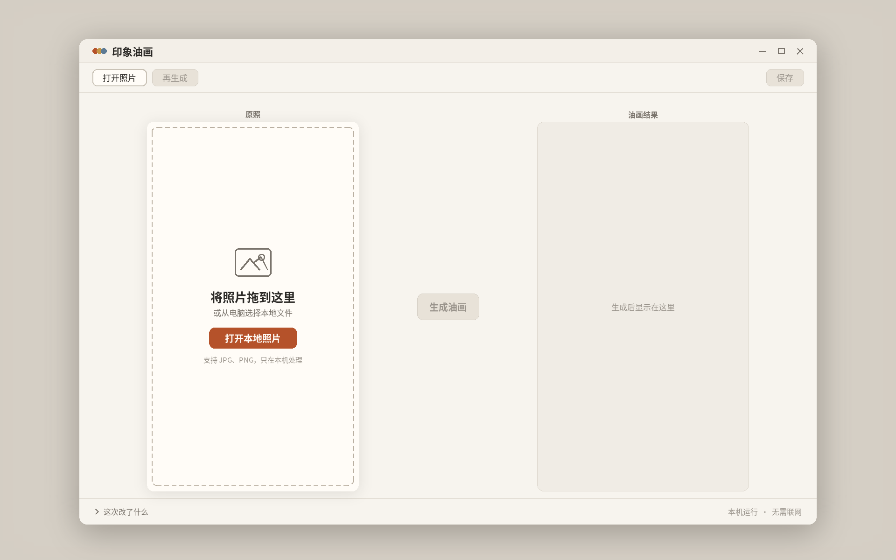
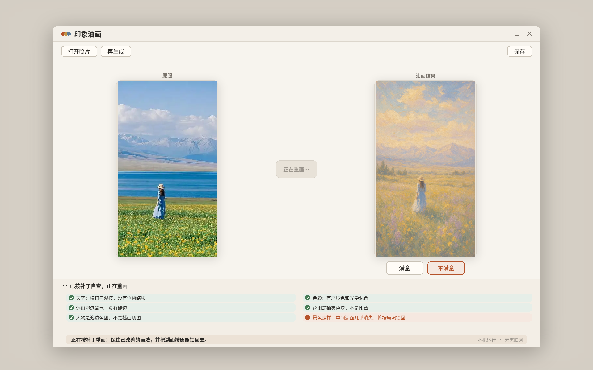
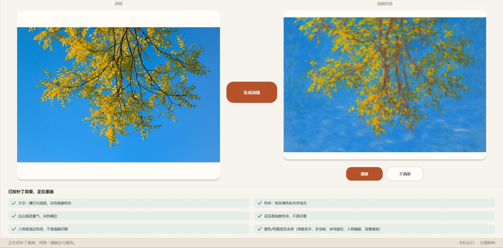

# 印象派油画生成 0.0.1

[中文](README.md) | [English](README.en.md) | [Deutsch](README.de.md)

Ein lokales, offline nutzbares Desktop-Programm: Öffnen Sie ein Foto auf Ihrem Rechner und erzeugen Sie mit einem Klick ein impressionistisches Ölgemälde.

Die Arbeitsfläche zeigt links das Originalfoto und rechts das Gemälde. Klicken Sie auf **生成油画** (Ölgemälde erzeugen). Wenn Sie unzufrieden sind, prüft das Programm das Ergebnis anhand seiner Qualitätsliste und erzeugt es mit einem Korrekturhinweis neu; wenn Sie zufrieden sind, können Sie speichern. Sie müssen nicht vorher zwischen Porträt und Landschaft wählen — das Programm beurteilt das Foto selbst und wendet die passende Malweise an.

Das ist kein Filter und kein „Ölmalerei-Shader“. Es erzeugt impressionistische Ölgemälde: Umgebungsfarbe, optische Mischung, weiche Kanten, die sich in die Luft auflösen, komplementäre Schatten. Die Komposition bleibt am Ausgangsfoto festgemacht.

## Oberfläche und Beispiele

Öffnen Sie das Programm und ziehen Sie ein Foto hinein, oder klicken Sie auf **打开照片** (Foto öffnen).



Nach der Erzeugung steht links das Original und rechts das Gemälde. Mit **不满意** (Unzufrieden) prüft das Programm Abweichungen in der Malweise und verrutschte Landschaft und erzeugt das Bild neu.



Hier ein echter Durchlauf auf diesem Rechner: ein Foto mit Ginkgoblättern wird zu einem impressionistischen Ölgemälde.



## Welche Bilder geeignet sind

Diese Version eignet sich nur für echte Kamerafotos, etwa Porträts, Landschaften und Alltagsaufnahmen. Animationsbilder, Illustrationen, Anime- oder Cartoon-Bilder, Comics, Screenshots und bereits gezeichnete Bilder sind ungeeignet; das Ergebnis wirkt dann in der Regel deutlich verfehlt.

## Voraussetzungen

Für ein halbwegs flüssiges Erzeugen sollten folgende Bedingungen erfüllt sein:

- **Grafikkarte**: Eine dedizierte NVIDIA-GPU mit mindestens 8 GB Videospeicher wird empfohlen. Geprüft auf einer NVIDIA GeForce RTX 4060 (Laptop, 8 GB). Standardmäßig wird die längere Bildkante auf 768 Pixel gesetzt; bei zu wenig Videospeicher erfolgt automatisch ein Fallback auf 512.
- **In dieser Version nicht unterstützt**: Rechner ohne NVIDIA-GPU, also auch solche mit nur integrierter Grafik, AMD-GPUs oder Apple Silicon (die Inferenz läuft über CUDA).
- **System und Python**: Windows 10 oder 11, Python 3.10 oder neuer (empfohlen: 3.12).
- **Festplatte**: Planen Sie etwa 8–10 GB ein. Die Modellgewichte umfassen rund 3,4 GB, dazu kommt die PyTorch-CUDA-Laufzeitumgebung.
- **Netzwerk**: Für die erstmalige Installation der Abhängigkeiten und den Modell-Download wird eine Verbindung benötigt. Danach kann das Programm offline laufen. Die Oberfläche startet keinen Modell-Download von selbst.

## Offline-Zusage

- Fotoauswahl, Erzeugung, Selbstprüfung und Speichern laufen vollständig auf diesem Rechner. Dateien werden nicht hochgeladen.
- Das Programm stellt standardmäßig keine Netzwerkanfragen und lädt Modelle nicht automatisch herunter.
- Sobald Abhängigkeiten und die lokalen Modelle installiert sind, funktioniert es auch ohne Netzwerk.

## Was in 0.0.1 enthalten ist — und was nicht

**Bereits nutzbar**

- Eine vollständige Benutzeroberfläche auf Chinesisch (Öffnen, Ziehen-und-Ablegen, Vergleich links/rechts, erneutes Erzeugen, Zurück zur Startansicht, Speichern).
- Der Ablauf **满意 / 不满意** (Zufrieden / Unzufrieden): „Unzufrieden“ prüft Abweichungen in der Malweise und verrutschte Landschaft und erzeugt das Bild mit Korrekturhinweisen neu.
- Eine lokale Engine aus SD 1.5 + ControlNet Tile + LoRA im impressionistischen Stil (zuerst Abhängigkeiten und Modelle wie unten installieren).
- Stil-Prompts, Szenenerkennung, die Prüfliste und die Zustandssteuerung der Pipeline (durch Tests abgedeckt).

**Modellgewichte liegen nicht in diesem Repository**

- Die Modelle sind etwa 3,4 GB groß und nicht Bestandteil dieses Repositories. Laden Sie sie mit den folgenden Schritten in den Ordner `models/` herunter.
- Wenn Sie auf **生成油画** klicken, bevor die Modelle installiert sind, erklärt die Oberfläche, was fehlt, startet aber **keinen automatischen Download**.

## Abhängigkeiten installieren

Sie benötigen Python 3.10 oder neuer (empfohlen: 3.12) sowie eine funktionsfähige NVIDIA-GPU.

```text
cd impression-oil
py -3 -m venv .venv
.venv\Scripts\activate
python -m pip install -U pip
python -m pip install -r requirements.txt
python -m pip install torch==2.6.0 torchvision==0.21.0 --index-url https://download.pytorch.org/whl/cu124
python -m pip install diffusers==0.43.0 transformers accelerate safetensors huggingface_hub peft
```

Installieren Sie `torch` über den offiziellen PyTorch-Index für CUDA 12.4, nicht die CPU-Variante. Unter Linux oder macOS verwenden Sie `python3` statt `py -3` und aktivieren die Umgebung mit `source .venv/bin/activate`. Der Erzeugungsweg wurde unter Windows mit einer NVIDIA-GPU geprüft.

Sie können auch nur die Oberfläche als editierbares Paket installieren (damit allein lassen sich noch keine Bilder erzeugen):

```text
python -m pip install -e .
```

## Lokale Modelle installieren

Führen Sie im aktivierten virtuellen Environment im Projektverzeichnis aus:

```text
python scripts/install_local_model.py
```

Die Modelle werden ins Verzeichnis `models/` des Projekts heruntergeladen, etwa 3,4 GB. Wenn Hugging Face unsicher erreichbar ist, setzen Sie zuerst einen Spiegel und starten Sie den Installer danach:

```text
set HF_ENDPOINT=https://hf-mirror.com
python scripts/install_local_model.py
```

Das ist nur einmal nötig. Danach funktioniert die Erzeugung offline. Beim ersten Klick auf **生成油画** in der Anwendung kann das Laden der Modelle etwa eine Minute dauern; spätere Läufe sind deutlich schneller. Das Laden der Modelle und das Erzeugen des Ölgemäldes braucht etwas Zeit; bitte haben Sie Geduld.

## Starten

Doppelklicken Sie im Projektordner auf `run.bat`, oder starten Sie es im Terminal:

```text
run.bat
```

`run.bat` verwendet bevorzugt das `.venv` des Projekts, danach `py -3`, zuletzt `python`. Es fügt `src` zu `PYTHONPATH` hinzu, Sie müssen das Paket also nicht vorher installieren. Im Repository liegt außerdem `launch.vbs`, damit Sie eine Desktop-Verknüpfung ohne Konsolenfenster anlegen können.

Sie können auch starten mit:

```text
python -m impression_oil
```

(Wenn Sie `run.bat` nicht verwenden, aktivieren Sie zuerst die virtuelle Umgebung oder setzen Sie `PYTHONPATH=src` selbst.)

## So funktionieren „Zufrieden“ und „Unzufrieden“

1. Öffnen oder ziehen Sie ein lokales JPG-/PNG-Foto (JPEG und WebP werden ebenfalls unterstützt).
2. Klicken Sie in der Mitte auf **生成油画**. Das Laden der Modelle und das Erzeugen des Ölgemäldes braucht etwas Zeit; bitte haben Sie Geduld. Sind die lokalen Modelle noch nicht installiert, erscheint ein Hinweis, der die Arbeit nicht unterbricht; der Rest der Oberfläche bleibt nutzbar.
3. Nach der Erzeugung erscheinen unter dem Ergebnis **满意** (Zufrieden) und **不满意** (Unzufrieden).
4. Klicken Sie auf **满意**: Das Ergebnis gilt als angenommen, und Sie können oben rechts auf **保存** (Speichern) klicken. Wurde noch nicht gespeichert, bleibt Speichern als Erinnerung verfügbar. Es wird nichts automatisch hochgeladen.
5. Klicken Sie auf **不满意**: Das Programm prüft das Ergebnis sofort am Ausgangsfoto (verklumpter Himmel, tote Lokalfarbe, harte ferne Berge, blumenfeldartige Stempel, Figuren wie aus einer Illustration, verrutschte Landschaft oder Komposition). Unten öffnet sich der Hinweis, dass nach der Korrekturliste geprüft und neu gemalt wird, in der Mitte steht „wird neu gemalt…“, und das ganze Bild wird mit Korrekturhinweisen erneut erzeugt (die verbesserte Malweise bleibt erhalten, verlorene oder verschobene Landschaft wird wieder an das Original gebunden). Wählen Sie erneut, wenn das neue Ergebnis da ist, bis Sie zufrieden sind.
6. Sobald ein Ergebnis fertig ist, können Sie oben in der Leiste auf **回到初始界面** (Zurück zur Startansicht) klicken und kehren zur leeren Ablagefläche zurück. Bereits gespeicherte Gemälde bleiben auf diesem Rechner und werden nicht gelöscht.

Der Speicher-Dialog trägt den Titel **保存油画** (Ölgemälde speichern). Der Standarddateiname sieht aus wie `originalname-印象派油画.jpg`. Sie können JPEG oder PNG speichern.

## Tests ausführen

```text
python -m pip install -r requirements.txt
python -m pytest
```

Diese Tests benötigen weder die Modelle noch eine GPU.

## Version

Die aktuelle Version ist **0.0.1**. Siehe `VERSION`, `pyproject.toml` und den Fenstertitel „印象派油画生成 0.0.1“.
